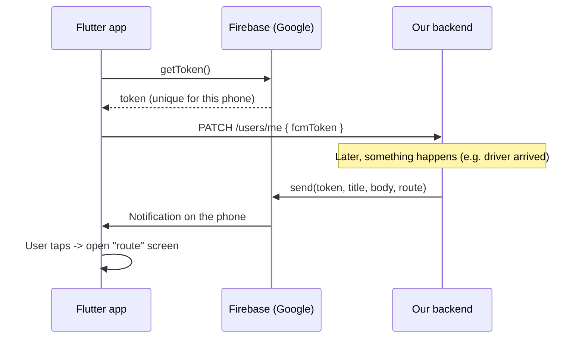

# Push notifications (Firebase Cloud Messaging)

Push notifications reach the phone **even when the app is closed**, for example:

| Who | When | Message |
|---|---|---|
| Driver | New request nearby | "New request: PKR 450 · 1.2 km away" |
| Passenger | A driver sends an offer | "New offer: PKR 500 · Bilal · Suzuki Alto · 3 min away" |
| Driver | Passenger chose him | "The passenger chose you! 🎉" |
| Passenger | Driver arrived | "Your driver has arrived 🚗" |
| Passenger | Trip finished | "You have arrived. Please pay PKR 500 in cash." |
| Both | Ride cancelled / new chat message | … |

When you tap the notification, the right screen opens.

**This is optional.** Without Firebase the app still works fully while it is open (it uses Socket.IO).

---

## Step 1 – Create a Firebase project (free)

1. Go to <https://console.firebase.google.com> and click **Add project**.
2. Give it a name (for example `indrive-clone`). Google Analytics is not needed.

## Step 2 – Connect the Flutter app

In a terminal:

```bash
# one time
npm install -g firebase-tools
firebase login
dart pub global activate flutterfire_cli

# inside the mobile folder
cd indrive_clone/mobile
flutterfire configure
```

- Choose your project, then choose **android** and **ios**.
- This **replaces** `lib/firebase_options.dart` with your real keys and adds
  `android/app/google-services.json` (and the iOS file).
- That is all for Android. Run the app again: `flutter run`.

### iOS only (needs a Mac and an Apple developer account)
1. In Xcode open `ios/Runner.xcworkspace` → Runner → **Signing & Capabilities** →
   add **Push Notifications** and **Background Modes** (tick *Remote notifications*).
2. In the Apple developer site create an **APNs key** (.p8).
3. Firebase console → Project settings → **Cloud Messaging** → upload the APNs key.

## Step 3 – Connect the backend

1. Firebase console → ⚙️ Project settings → **Service accounts** → **Generate new private key**.
   A JSON file is downloaded. **Keep it secret. Never put it in Git.**
2. Copy it to `backend/firebase-service-account.json` (this name is in `.gitignore`).
3. In `backend/.env` set:
   ```
   FIREBASE_SERVICE_ACCOUNT=./firebase-service-account.json
   ```
4. Restart the backend. You should see: `🔔 Firebase push notifications are ON`.

With Docker, mount the file and set the variable in `docker-compose.yml`:
```yaml
  api:
    environment:
      FIREBASE_SERVICE_ACCOUNT: /app/firebase-service-account.json
    volumes:
      - ./backend/firebase-service-account.json:/app/firebase-service-account.json:ro
```

## How it works



- App code: `mobile/lib/core/push/push_service.dart` (token, showing notifications when the app is open, opening screens).
- Backend code: `backend/src/lib/push.ts` (`sendPush(userId, {title, body, route})`).
- On logout the token is removed, so the old account gets no more pushes on this phone.
- If a token is old (app uninstalled), the backend deletes it automatically.

## Test it
1. Start backend + simulator: `npm run dev` and `npm run simulate`.
2. Log in on a real phone (emulators need Google Play services for FCM).
3. Order a ride, then **close the app**. You will get "New offer" notifications.
