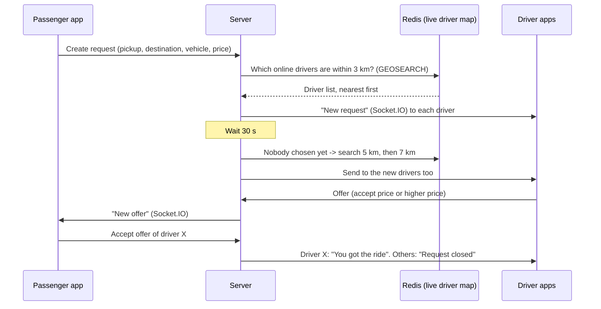
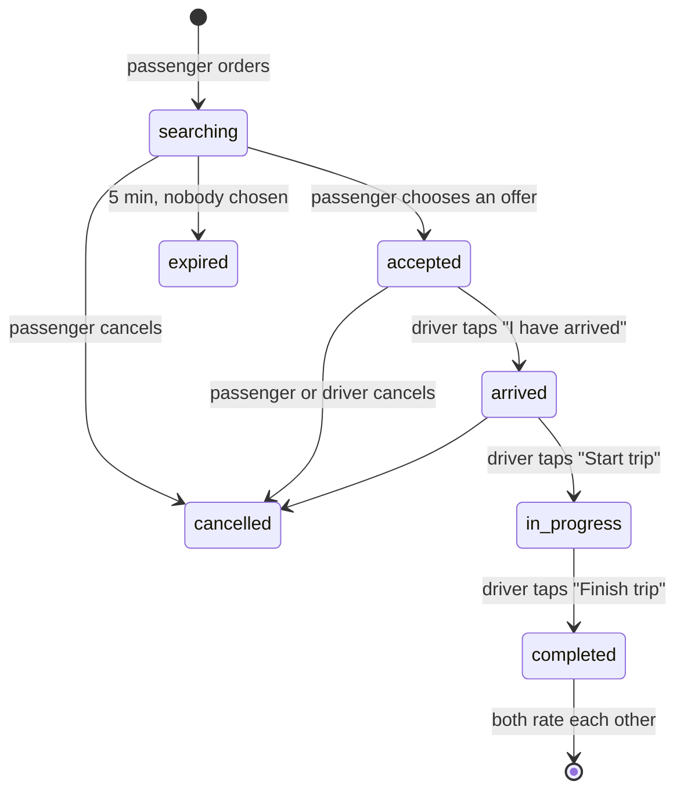

# How InDrive works (and how this clone copies it)

This page explains the InDrive app in simple words. Each part also says where it lives in this project.

> This study is based on how the public InDrive Pakistan app behaves for a normal user and driver.
> We did not copy any InDrive code, images or logo. "inDrive" is a trademark of its owner. This is a student project for learning.

---

## 1. The big idea: "you set the price"

Most ride apps (Uber, Careem) decide the price. **InDrive is different:**

1. The **passenger** chooses pickup and destination.
2. The app shows a **recommended fare**. The passenger can type **any price** above a minimum.
3. Nearby **drivers** see the request with the price. Each driver can:
   - **accept** the price, or
   - send a **counter-offer** (a higher price), or
   - **skip** it.
4. The passenger sees a list of offers (driver name, rating, car, arrival time, price). The passenger **chooses one driver**.

This is called **bidding**. It is the heart of the app.

| Step | Where in code |
|---|---|
| Recommended + minimum fare | `backend/src/modules/rides/fare.ts` |
| Passenger offers a price | `mobile/lib/features/passenger/order_sheets.dart` → `showFareSheet` |
| Driver accepts / counter-offers | `mobile/lib/features/driver/request_sheet.dart` |
| Passenger chooses an offer | `mobile/lib/features/passenger/ride_screen.dart` → `_OfferCard` |
| Server rules (price checks, one winner) | `backend/src/modules/rides/rides.service.ts` → `makeOffer`, `acceptOffer` |

---

## 2. How the driver is found (2-3 km circle)

The rules (you can change them in `backend/.env`):

| Rule | Value | Setting |
|---|---|---|
| First search circle | 3 km | `INITIAL_RADIUS_M` |
| Circle grows by | 2 km | `RADIUS_STEP_M` |
| Biggest circle (city) | 7 km | `MAX_RADIUS_M` |
| Grow every | 30 s | `EXPAND_EVERY_SEC` |
| Request closes after | 5 min | `REQUEST_TTL_SEC` |
| A driver offer is valid for | 45 s | `OFFER_TTL_SEC` |
| City-to-city search circle | 25 km | in `config/env.ts` |

Who gets the request? A driver must be:
- **online** and his GPS was updated in the last 2 minutes,
- **approved** (documents checked),
- using the **same vehicle type** (Moto, Rickshaw, Ride Mini, Ride A/C, Comfort, Loader, Truck),
- doing this **service** (City, City to City, Courier, Freight),
- **not busy** with another ride,
- with a balance of **0 or more** (InDrive blocks drivers who owe commission).

Code: `backend/src/modules/rides/matching.service.ts`.

### Why Redis for driver locations?
Drivers send their GPS every 2-3 seconds. Writing this to the main database is slow and not needed.
Redis keeps it in memory and has a `GEOSEARCH` command: "give me all points within 3 km of here, nearest first".
This is how real ride apps do it. Code: `backend/src/modules/drivers/location.store.ts`.

### Why timed jobs (BullMQ)?
"Make the circle bigger after 30 s" and "close the offer after 45 s" must happen even if the server restarts.
BullMQ keeps these timers in Redis. Code: `backend/src/jobs/queue.ts`.

---

## 3. After the driver is chosen: live tracking

### The driver is coming to me
- The driver app sends GPS to the server every 2 s (`driver:location` socket event).
- The server sends it to the passenger with **distance** and **arrival time (ETA)**.
- The passenger map shows the car moving and turning (heading).

### Am I walking towards the driver?
InDrive also shows the **passenger's position to the driver**. We do the same:
- During `accepted` and `arrived`, the passenger app sends its GPS (`passenger:location`).
- The driver sees a blue dot and a message:
  *"Passenger is walking to the pickup point (120 m)"* or *"…is moving away"*.
- The passenger also sees *"You are moving towards the pickup point"* or *"…away"*.
- How do we know? We keep the last few distances to the pickup. Going down → closer. Going up → away.
  Small changes (GPS noise) are ignored. Code: `ApproachTracker` in `mobile/lib/core/utils/geo.dart`.

### Waiting time
After "I have arrived", both apps show a waiting timer. (InDrive gives a few free minutes.)

### Finish and pay
- Payment is **cash** (most common in Pakistan).
- The service takes **10 % commission** from the **driver balance** (the driver keeps all the cash).
- If the balance goes below 0, the driver must **top up** (JazzCash / Easypaisa / card – a demo in this project).
- Both people **rate** each other (1-5 stars). Ratings are averages and are shown in offers and requests.

---

## 4. All features and where they are

| Feature (InDrive) | Clone | Code |
|---|---|---|
| Language choice at start (English / Urdu) | ✅ | `features/auth/onboarding_screen.dart`, `core/l10n/strings.dart` |
| Login with phone number + SMS code (OTP) | ✅ (+92 numbers) | `features/auth/*`, `backend/src/modules/auth/*` |
| Name and photo | ✅ | `profile_setup_screen.dart`, `profile_screens.dart` |
| Map with cars around you | ✅ | `passenger/home_screen.dart`, `GET /drivers/nearby` |
| Move map pin to set pickup | ✅ | `home_screen.dart` (`_onMapMoved`) |
| Search address / choose on map | ✅ | `place_search_screen.dart`, `pick_on_map_screen.dart` |
| Home / Work / recent places | ✅ | `settings` + `GET /rides/recent-places` |
| Services: City, City to City, Courier, Freight | ✅ | `core/utils/vehicles.dart`, `fare.ts` |
| Vehicle types: Moto, Rickshaw, Mini, A/C, Comfort, Loader, Truck | ✅ | same |
| Recommended + minimum fare | ✅ | `fare.ts` |
| Offer your own price | ✅ | `order_sheets.dart` |
| Comments, child seat, pet, courier receiver, intercity date & seats, freight loaders | ✅ | `showOptionsSheet` |
| Search circle grows, drivers counter-offer | ✅ | `matching.service.ts` |
| Raise fare while waiting | ✅ | `PATCH /rides/:id/fare` |
| List of offers with timer, accept / decline | ✅ | `ride_screen.dart` |
| Live driver tracking + ETA | ✅ | Socket.IO `driver:location` |
| Passenger location for the driver + "walking towards / away" | ✅ | Socket.IO `passenger:location` |
| Call driver / passenger | ✅ (phone call) | `callPhone` |
| In-app chat with quick replies | ✅ | `chat_screen.dart` |
| Share trip with family | ✅ | `tripShareText` |
| Safety: SOS (Police 15, Rescue 1122, Ambulance 115) + SOS alert to admin | ✅ | `showSafetySheet`, admin page |
| Cancel with reason (both sides) | ✅ | `askCancelReason` |
| Rating both ways + tags | ✅ | `rate_screen.dart`, driver dialog |
| Ride history + details | ✅ | `history_screen.dart` |
| One app, Passenger mode ↔ Driver mode | ✅ | `app_drawer.dart` |
| Driver sign-up: selfie, CNIC, license, vehicle, plate, photos | ✅ | `driver_register_screen.dart` |
| Document check by admin | ✅ (`/admin` page, or auto approve) | `admin.routes.ts`, `public/admin.html` |
| Online / Offline switch | ✅ | `driver_home_screen.dart` |
| Order feed with distance, price, passenger rating | ✅ | `RequestCard` |
| Navigate with Google Maps | ✅ (opens the app) | `driver_ride_screen.dart` |
| GPS keeps working with screen off (driver) | ✅ Android foreground service | `location_service.dart` |
| Earnings (today / week / month), commission, wallet, top-up | ✅ (demo payment) | `earnings_screen.dart` |
| Push notifications | ✅ Firebase Cloud Messaging | `core/push/push_service.dart`, `backend/src/lib/push.ts` |
| Dark mode | ✅ | `app_theme.dart` |
| Restore ride after app restart | ✅ | `GET /rides/active` |

### Not included (needs a real company / paid services)
- Real SMS (code is printed in the server log; Twilio is ready in `sms.ts`, just add keys).
- Real card / JazzCash payments (the top-up is a demo).
- Face check of drivers (InDrive uses face recognition). We use a selfie + admin check.
- Turn-by-turn voice navigation inside the app (we open Google Maps instead, like many drivers do).
